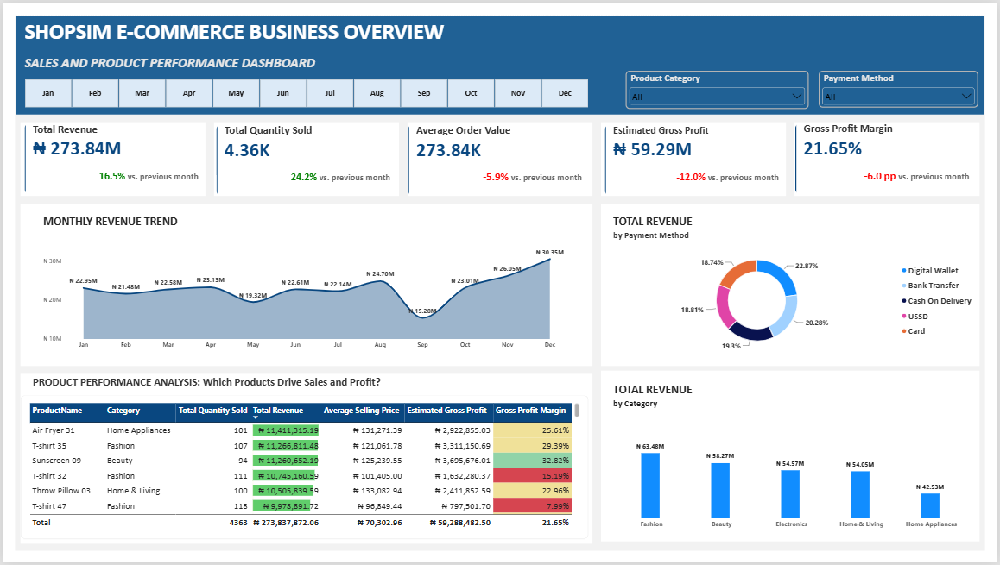
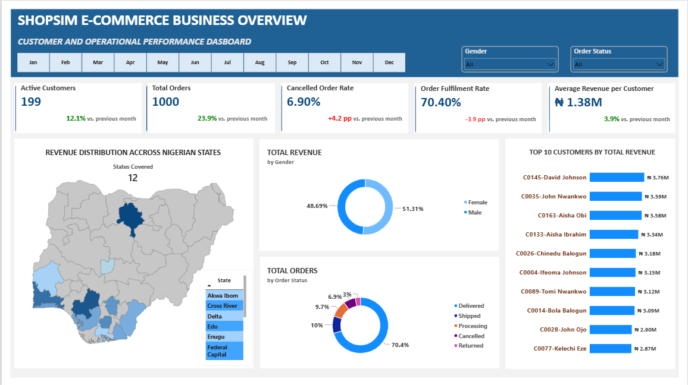

### ShopSim-Ecommerce-Analysis
An e-commerce data analysis project using Excel, Power Query and Power BI to explore sales, product performance, customer behaviour, profitability and order fulfilment through interactive dashboards.

### Dashboard Preview
#### Sales and Product Performance

#### Customer and Operational Performance

### Project Overview
ShopSim E-commerce Analysis is a data analytics project based on a simulated e-commerce business. The project examines the business's performance over a 12-month period, from January to December 2025. The analysis goes beyond sales figures to explore product performance, customer behaviour, profitability, geographical sales distribution and order fulfilment. Microsoft Excel, Power Query and Power BI were used to prepare, analyse and present the data through an interactive dashboard.

### Project Objectives
The main objectives of this project were to:
- Examine and prepare the e-commerce dataset for analysis.
- Evaluate overall business performance using key performance indicators (KPIs).
- Analyse monthly revenue trends.
- Identify high-performing products and product categories.
- Examine estimated gross profit and profit margins.
- Understand customer purchasing patterns and revenue contributions.
- Analyse revenue distribution across Nigerian states.
- Examine order statuses, cancellations and fulfilment performance.
- Present the findings through an interactive Power BI dashboard.

### Business Questions
The analysis was designed to answer questions such as:
- How much revenue did the business generate?
- How did revenue change from month to month?
- Which product categories generated the highest revenue?
- Which individual products performed best?
- How profitable were the products?
- Which customers contributed the most revenue?
- How was revenue distributed across Nigerian states?
- What percentage of orders were successfully delivered?
- How many orders were cancelled or returned?

### Dataset Description
The project used a simulated e-commerce dataset covering January to December 2025. The dataset contained four main tables:
1. Customers: Contains customer information, including demographic and location details.
2. Products: Contains product information and pricing details.
3. Orders: Contains order dates, payment methods and order statuses.
4. OrderDetails: Contains individual products purchased, quantities, selling prices and discounts.

#### A separate Calendar table was also created to support monthly and time-based analysis.
#### Note: The dataset was created for learning and portfolio demonstration. It does not represent the actual records of a registered business.

### Tools Used
- Microsoft Excel: Initial data inspection and preparation.
- Power Query: Data cleaning and transformation.
- Power BI Desktop: Data modelling, analysis and dashboard development.
- DAX: Creating calculations and key performance indicators.

### Data Cleaning and Preparation
The four datasets were examined to identify missing information, duplicate records, inconsistent entries and formatting problems. The cleaning process included:
- Removing duplicate records.
- Standardising text entries and categories.
- Correcting date and numeric formats.
- Identifying missing and invalid values.
- Checking customer and product references.
- Preparing the tables for analysis.
A total of 30 data quality issues were identified. Nineteen were corrected, while 11 were documented because the required information was unavailable. Missing information was not replaced with guessed values. Check the data Quality log sheet for more information.

